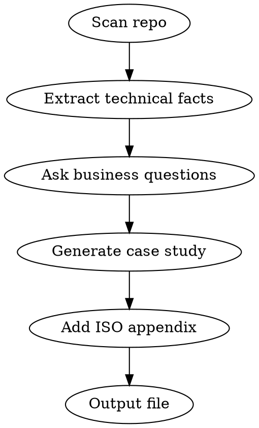

# Case Study Generator

## Overview

Analyzes the current project repo and generates a publish-ready case study in three layers: a full website version, a concise LinkedIn post, and an ISO 9001:2015 internal QMS project record appendix.

## When to Use

- Project is completed or at a significant milestone
- User runs `/case-study` in any project directory
- Team needs marketing content for a delivered project

## Workflow



### Step 1: Repo Analysis

Automatically extract from the project:

```bash
git log --oneline --since="1 year ago" | head -50    # Timeline, team size
find . -name "package.json" -o -name "requirements.txt" -o -name "Gemfile" -o -name "go.mod" -o -name "*.csproj" | head -5
cat README.md 2>/dev/null
ls .planning/ 2>/dev/null
find . -name "*.md" -path "*planning*" | head -10
git shortlog -sn --no-merges | head -10
```

Build an internal summary of:
- **Project name and description**
- **Tech stack** (languages, frameworks, databases, cloud services)
- **Timeline** (first commit to latest, or milestone dates)
- **Scale indicators** (file count, test count, lines of code)
- **Team size** (unique git contributors)
- **Architecture** (monorepo/microservices, frontend/backend split)

### Step 2: Ask Targeted Questions

Use AskUserQuestion. Ask only what's missing from the repo.

**Required questions (always ask):**

1. **Client & Industry**: "Who is the client and what industry are they in? (Use real name or 'confidential' for anonymized version)"
2. **Problem**: "What business problem were they trying to solve?"
3. **Outcomes**: "What measurable results did this deliver? (or 'still in progress')"
4. **Quote** (optional): "Do you have a client testimonial? (Skip if none)"

**Conditional questions (ask only if not derivable from repo):**

- If no README or planning docs: "In 1-2 sentences, what does this project do?"
- If timeline unclear: "When did this project start and end?"
- If no deployment indicators: "Where is this deployed?"

### Step 3: Generate Case Study

Produce `CASE-STUDY.md` in the project root with all three layers:

#### Full Document Structure

```markdown
# [Project Name]: [Compelling One-Line Result]

## Client Overview

| | |
|---|---|
| **Industry** | [Industry] |
| **Region** | [Client region / operations region] |
| **Company Size** | [Startup / SME / Enterprise] |
| **Engagement** | [Full build / Enhancement / Consulting] |
| **Duration** | [Start month year — End month year or "ongoing"] |

## The Challenge
[2-3 paragraphs: Client context, specific problem, what they used before, why it mattered]

## Our Approach
[2-3 paragraphs: How 7th Pillar approached it, key technical decisions, methodology]

## The Solution
[2-3 paragraphs: What was built, architecture highlights, key features]

### Tech Stack
[Bullet list of technologies]

## The Results
[Bullet points with specific metrics]

> "[Client testimonial if provided]"
> — [Name, Title, Company]

## Team & Timeline

| | |
|---|---|
| **Start Date** | [Date] |
| **Duration** | [X months] |
| **Team Size** | [Roles involved] |
| **Methodology** | [Agile / Waterfall / etc.] |

## Key Takeaways
[2-3 bullets: What made this successful]

---

*Interested in building something similar? Contact 7th Pillar Infotech — [hello@7thpillar.com](mailto:hello@7thpillar.com)*

---

## LinkedIn Version

[Attention-grabbing opening with key result]

[2-3 short paragraphs: problem → approach → outcome]

Key highlights:
- [Metric 1]
- [Metric 2]
- [Metric 3]

[Call to action]

#7thPillar #[IndustryTag] #[TechTags]

---
---

## Internal — QMS Project Record (ISO 9001:2015)

> This section is for internal use and ISO audit evidence. Do not publish externally.

### Document Control (Clause 7.5)

| Field | Value |
|-------|-------|
| **Document ID** | CS-[PROJECT-CODE]-001 |
| **Version** | 1.0 |
| **Date Created** | [Today's date] |
| **Author** | [Author name] |
| **Approved By** | _[Pending]_ |
| **Status** | Draft |
| **Classification** | Internal / Confidential |

### Scope & Acceptance Criteria (Clause 8.2.3)

**Project Scope:**
- [Bullet list of what was agreed to build — derive from README/planning docs]

**Acceptance Criteria:**
- [Measurable criteria that define "done" — derive from tests/issues]

### Process & Methodology (Clause 8.1)

| Process | Description |
|---------|-------------|
| **SDLC** | [Methodology — derive from git workflow] |
| **Version Control** | [Git workflow — derive from branch naming] |
| **Code Review** | [Review process — derive from PR history] |
| **Testing** | [Testing approach — derive from test files/docs] |
| **Change Control** | [How changes are managed] |
| **Deployment** | [Pipeline — derive from config files] |

### Verification & Validation (Clause 8.6)

| Method | Evidence |
|--------|----------|
| [Review type] | [Actual path/link in repo] |
| [Testing type] | [Actual path/link in repo] |
| [Validation type] | [Actual path/link in repo] |

### Team Competence (Clause 7.2)

| Role | Responsibilities |
|------|-----------------|
| [Role] | [What they did] |

_Competence records (CVs, certifications) maintained in HR system._

### Customer Satisfaction (Clause 9.1.2)

| Method | Status |
|--------|--------|
| [Feedback method] | [Current status] |

### Nonconformities & Corrections (Clause 10.2)

| Date | Issue | Correction | Status |
|------|-------|-----------|--------|
| — | [Or "No major nonconformities recorded"] | — | — |

_Issues tracked via [issue tracker — derive from repo]._

### Linked Records

- [Links to repo, QMS docs, test results, project docs — use actual paths found in repo]
```

## Writing Guidelines

- **Lead with results**, not technology
- **Use specific numbers** ("reduced from 45s to 3s" not "significantly faster")
- **Avoid jargon** in the marketing sections — executives read these
- **LinkedIn version**: Max 1300 characters, punchy, shareable
- **Anonymize if requested**: Replace client name with "[Industry Leader]" or similar
- **ISO appendix**: Always reference actual file paths and evidence found in the repo
- **Document Control**: Generate a document ID using format CS-[PROJECT]-001
- **Tone**: Professional but not stiff. Let results speak.

## Output

Write `CASE-STUDY.md` to the project root. Inform the user:

1. Where the file was saved
2. That it contains website version, LinkedIn post, and ISO internal record
3. Suggest review before publishing (numbers, claims, client approval)
4. Note the `[Pending]` fields in the ISO section that need sign-off

## Quick Reference

| What | Source |
|------|--------|
| Project name | README, package.json, repo name |
| Tech stack | Dependencies, file extensions, configs |
| Timeline | Git log first/last commits |
| Team size | Git shortlog contributors |
| Problem statement | User input (always ask) |
| Business outcomes | User input (always ask) |
| Architecture details | Code analysis |
| ISO process evidence | Git PRs, test files, docs/ directory |
| Scope & criteria | Planning docs or user input |

## Common Mistakes

- Writing a technical doc instead of a marketing case study
- Burying results at the bottom instead of leading with them
- Using developer jargon that non-technical readers won't understand
- Making the LinkedIn post too long (truncates after ~1300 chars)
- Forgetting to suggest client approval before publishing
- Leaving the ISO appendix generic — always reference actual evidence paths from the repo
- Omitting Document Control metadata (auditors check this first)
