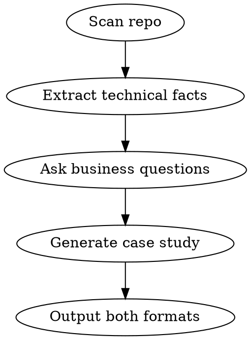

# Case Study Generator

## Overview

Analyzes the current project repo and generates a publish-ready case study in two formats: a full website version and a concise LinkedIn post. Extracts what it can from code and asks targeted questions for business context.

## When to Use

- Project is completed or at a significant milestone
- User runs `/case-study` in any project directory
- Team needs marketing content for a delivered project

## Workflow



### Step 1: Repo Analysis

Automatically extract from the project:

```bash
# What to scan (run these silently, don't dump raw output to user)
git log --oneline --since="1 year ago" | head -50    # Timeline, team size
find . -name "package.json" -o -name "requirements.txt" -o -name "Gemfile" -o -name "go.mod" -o -name "*.csproj" | head -5  # Tech stack
cat README.md 2>/dev/null                             # Project description
ls .planning/ 2>/dev/null                             # Planning docs if GSD project
find . -name "*.md" -path "*planning*" | head -10     # Phase/milestone docs
git shortlog -sn --no-merges | head -10               # Contributors
```

From this, build an internal summary of:
- **Project name and description**
- **Tech stack** (languages, frameworks, databases, cloud services)
- **Timeline** (first commit to latest, or milestone dates)
- **Scale indicators** (file count, test count, lines of code)
- **Team size** (unique git contributors)
- **Architecture** (monorepo/microservices, frontend/backend split)

### Step 2: Ask Targeted Questions

Use AskUserQuestion to fill gaps code can't tell you. Ask only what's missing.

**Required questions (always ask):**

1. **Client & Industry**: "Who is the client and what industry are they in? (Use real name or 'confidential' for anonymized version)"
2. **Problem**: "What business problem were they trying to solve? What was the pain point before this project?"
3. **Outcomes**: "What measurable results did this deliver? (e.g., 40% faster processing, $200K annual savings, 3x user growth)"
4. **Quote** (optional): "Do you have a client testimonial or quote we can include? (Skip if none)"

**Conditional questions (ask only if not derivable from repo):**

- If no README or planning docs: "In 1-2 sentences, what does this project do?"
- If timeline unclear from git: "When did this project start and end?"
- If no clear deployment indicators: "Where is this deployed? (AWS, GCP, on-prem, etc.)"

### Step 3: Generate Case Study

Produce a file `CASE-STUDY.md` in the project root with both formats:

#### Website Format Structure

```markdown
# [Project Name]: [Compelling One-Line Result]

## The Challenge
[2-3 paragraphs: Client context, industry, specific problem, what they tried before, why it mattered]

## Our Approach
[2-3 paragraphs: How 7th Pillar approached the problem, key technical decisions, methodology]

## The Solution
[2-3 paragraphs: What was built, architecture highlights, key features, integrations]

### Tech Stack
[Bullet list of technologies used]

## The Results
[Bullet points with specific metrics and outcomes]

> "[Client testimonial if provided]"
> — [Name, Title, Company]

## Key Takeaways
[2-3 bullets: What made this project successful, reusable insights]
```

#### LinkedIn Post Format

```markdown
---

## LinkedIn Version

[Attention-grabbing opening line with the key result]

[2-3 short paragraphs: problem → approach → outcome]

Key highlights:
- [Metric 1]
- [Metric 2]  
- [Metric 3]

[Call to action: link to full case study or contact]

#7thPillar #[IndustryTag] #[TechTags]
```

## Writing Guidelines

- **Lead with results**, not technology
- **Use specific numbers** wherever possible ("reduced from 45s to 3s" not "significantly faster")
- **Avoid jargon** in the website version — executives read these, not just developers
- **LinkedIn version**: Max 1300 characters (LinkedIn preview cutoff), punchy, shareable
- **Anonymize if requested**: Replace client name with "[Industry Leader]" or similar
- **Include relevant hashtags** for LinkedIn based on industry and tech stack
- **Tone**: Professional but not stiff. Confident but not salesy. Let the results speak.

## Output

Write `CASE-STUDY.md` to the project root directory. Inform the user:

1. Where the file was saved
2. That it contains both website and LinkedIn versions
3. Suggest they review and adjust any numbers/claims before publishing
4. Remind them to get client approval if using their name/quote

## Quick Reference

| What | Where it comes from |
|------|-------------------|
| Project name | README, package.json, repo name |
| Tech stack | Dependencies, file extensions, configs |
| Timeline | Git log first/last commits |
| Team size | Git shortlog contributors |
| Problem statement | User input (always ask) |
| Business outcomes | User input (always ask) |
| Architecture details | Code analysis |
| Client testimonial | User input (optional) |

## Common Mistakes

- Writing a technical doc instead of a marketing case study
- Burying the results at the bottom instead of leading with them
- Using developer jargon that non-technical readers won't understand
- Making the LinkedIn post too long (gets truncated after ~1300 chars)
- Forgetting to suggest client approval before publishing
